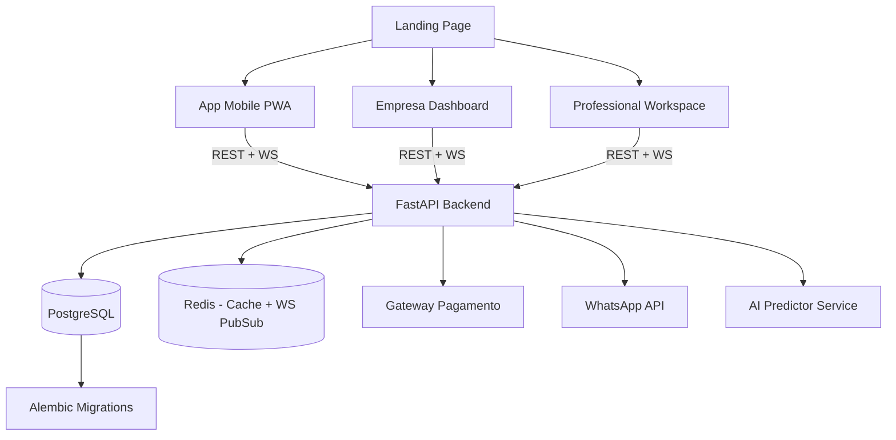

# 📋 FilaFlow — Documento de Contexto & Análise do Projeto

> **Gerado automaticamente em:** 2026-10-15  
> **Sistema:** Windows 11 Pro (25H2) | AMD Ryzen 5 5500X3D | RX 6750 XT | 16 GB RAM  
> **Propósito:** Mapa completo do estado atual do projeto, jornadas dos usuários, status de funcionalidades e direção de crescimento.

---

## 🧠 Visão Geral do Projeto

**FilaFlow** é um Sistema Inteligente de Gestão e Previsão de Filas em Tempo Real, projetado para estabelecimentos que operam com atendimento por ordem de chegada ou agendamento:
- Clínicas e consultórios
- Salões de beleza e barbearias
- Laboratórios e centros de diagnóstico
- Restaurantes
- Oficinas
- Órgãos públicos

**Diferencial principal:** Além de gerenciar a fila, o FilaFlow usa dados históricos dos atendimentos para fazer previsões inteligentes de tempo de espera, considerando: duração de atendimentos anteriores, quantidade de pessoas aguardando, número de profissionais disponíveis, horário e tipo de serviço.

**Modelo de negócio:** SaaS B2B (a empresa paga a assinatura) com app mobile B2C gratuito para o cliente final.

---

## 🏗️ Stack Tecnológica

### Frontend
| Tecnologia | Versão | Função |
|---|---|---|
| React | 19.0.0 | UI Framework |
| Vite | 6.2.0 | Build tool / Dev server |
| Tailwind CSS | via `index.css` | Styling (inline + classes) |
| lucide-react | 1.16.0 | Ícones |
| clsx | 2.1.1 | Utilitário de classes condicionais |

> **Nota:** Tailwind **não está instalado como dependência** no `package.json`. O CSS está sendo compilado manualmente no `src/index.css` com ~22.000+ linhas de CSS puro + animações. Isso é um debt técnico importante.

### Backend
| Tecnologia | Versão | Função |
|---|---|---|
| FastAPI | 0.142.2 | Framework HTTP + WebSocket |
| Uvicorn | 0.54.0 | ASGI Server |
| Pydantic | 2.13.5 | Validação de dados / Schemas |
| PyJWT | 2.15.1 | Autenticação JWT |
| pwdlib[argon2] | 0.3.1 | Hash de senhas (Argon2) |
| websockets | 17.2 | Protocolo WebSocket |
| pytest + httpx | 9.1.1 / 0.28.1 | Testes |
| PostgreSQL | *(não configurado)* | Banco de dados (preparado, não ativo) |

### Infraestrutura de Dev
- **Porta Frontend:** `5174` (Vite)
- **Porta Backend:** `8000` (Uvicorn)
- **Script de inicialização:** `iniciar_tudo.bat` (abre dois terminais separados)
- **Proxy Vite→Backend:** Configurado no `vite.config.js` (proxy `/api` e `/ws` para `localhost:8000`)

---

## 👤 Atores / Usuários do Sistema

O FilaFlow possui **4 perfis de usuário** distintos, cada um com sua própria interface e jornada:

### 1. 🏢 Empresa (B2B — Administrador da Fila)
- **Rota:** `/empresa` e `/empresa/dashboard`
- **Quem é:** Recepcionista, gestor ou dono do estabelecimento
- **Autenticação:** JWT via email + senha (backend real)
- **Status:** ✅ **Parcialmente funcional** (auth + fila integrada ao backend)

### 2. 📱 Cliente (B2C — Usuário Final / Paciente)
- **Rota:** `/app`
- **Quem é:** Qualquer pessoa aguardando atendimento
- **Autenticação:** Local (localStorage), sem backend real ainda
- **Status:** ⚠️ **Interface completa, backend não integrado**

### 3. 🩺 Profissional (Médico / Atendente)
- **Rota:** `/profissional`
- **Quem é:** O médico, barbeiro, chef ou qualquer prestador de serviço
- **Autenticação:** Sem autenticação real (dados mock)
- **Status:** ⚠️ **Interface completa, tudo em dados mock**

### 4. 💳 Checkout / Onboarding de Empresa
- **Rota:** `/checkout`
- **Quem é:** Responsável pela empresa no momento de assinar o plano
- **Autenticação:** Nenhuma (fluxo público)
- **Status:** ⚠️ **Interface completa, sem integração de pagamento**

---

## 🗺️ Jornadas dos Usuários

### Jornada 1 — Cliente (Usuário Final)
```
1. Acessa o site (Landing Page /)
   → Vê demonstração da fila em tempo real

2. Baixa/acessa o App Mobile (/app)
   → Tela de login/cadastro (MobileAuthView)

3. Encontra o estabelecimento
   ├── Via QR Code (QrScannerModal → simula scan)
   └── Via busca (QueueSearchModal → lista mockData)

4. Faz Pré-checkin (PreCheckinModal)
   → Escolhe serviço
   → Confirma nome e telefone
   → Entra na fila (estado local, sem backend)

5. Acompanha posição na fila (MobileDashboard)
   → Vê posição, tempo estimado, pessoas à frente
   → Pode pedir "mais tempo" (troca de posição)
   → Pode avisar "estou a caminho"
   → Pode fazer checkin com a recepcionista

6. É chamado
   → Toast + chime sonoro
   → Status atualiza para "chamado"

7. É atendido / Desiste
   → Remove a fila do app
```

### Jornada 2 — Empresa (Recepção/Gestão)
```
1. Acessa o site (Landing Page /)
   → Vê proposta de valor e planos

2. Assina o plano (/checkout)
   → Escolhe plano (Starter/Profissional/Enterprise)
   → Preenche dados da empresa
   → [TODO] Pagamento via Pix/Cartão/Boleto

3. Onboarding (/empresa → CompanyOnboarding)
   → [DETALHE: Onboarding UI existe mas não tem rota direta]

4. Login na plataforma (/empresa → CompanyLogin)
   → Autentica com email + senha via JWT
   → Backend FastAPI valida credenciais

5. Painel de gestão (/empresa/dashboard → CompanyDashboard)
   → Vê senha atual em atendimento
   → Vê fila de espera
   → Chama próxima senha (integrado ao backend)
   → Emite senha manual na recepção (integrado ao backend)
   → Recebe atualizações em tempo real via WebSocket

6. Recepção / Triagem (ReceptionDeskView)
   → Lista de espera da recepção
   → [TODO] Autoriza convênio do cliente
   → [TODO] Encaminha para a fila do médico
```

### Jornada 3 — Profissional (Médico/Atendente)
```
1. Acessa /profissional (via link direto ou botão na Navbar)
   → Seleciona seu perfil (mock: Dr. Carlos, Dra. Beatriz, Chef Marcelo)

2. Visualiza ProfessionalWorkspace
   → Vê senha atual em atendimento
   → Vê lista de espera com status de cada paciente
   → Vê histórico do dia
   → Pode ver onde o paciente está (saguão, cafeteria, a caminho)

3. Ações do consultório
   → [TODO] Chamar próxima senha
   → [TODO] Finalizar atendimento
   → [TODO] Reportar atraso
   → [TODO] Todas integradas ao backend
```

---

## 🗂️ Organização Atual do Código

### Estrutura de Arquivos Comentada
```
FilaFlow/
├── 📄 CONTEXT.md                    ← Este arquivo
├── 📄 package.json                  ← Deps frontend (React 19, Vite 6)
├── 📄 vite.config.js                ← Proxy /api e /ws → backend:8000
├── 📄 iniciar.bat                   ← Inicia só o frontend
├── 📄 iniciar_tudo.bat              ← Inicia frontend + backend
├── 📄 index.html                    ← Entry point HTML
├── ⚠️  index-DqFyq8RU.js           ← Bundle buildado commitado (DEVE SER REMOVIDO)
│
├── src/
│   ├── 📄 main.jsx                  ← Ponto de entrada React
│   ├── 📄 App.jsx                   ← Roteador principal + estado global (757 linhas)
│   ├── 📄 index.css                 ← ⚠️ 22k+ linhas de CSS (DEBT TÉCNICO)
│   │
│   ├── router/
│   │   └── 📄 useAppRouter.js       ← Router customizado baseado em History API
│   │
│   ├── services/
│   │   └── 📄 api.js                ← Client HTTP + WebSocket + gerenciamento de token JWT
│   │
│   ├── data/
│   │   └── 📄 mockData.js           ← Todos os dados fake para demonstração
│   │
│   └── components/
│       ├── LandingPage/
│       │   ├── 📄 LandingPage.jsx           ← Site institucional completo
│       │   ├── 📄 Navbar.jsx                ← Navegação principal
│       │   └── 📄 InteractiveHeroPhone.jsx  ← Preview do app no hero
│       │
│       ├── Client/
│       │   ├── 📄 ClientMobileApp.jsx       ← Container do app mobile (tabs)
│       │   ├── 📄 MobileAuthView.jsx         ← Login/Cadastro do cliente
│       │   ├── 📄 MobileDashboard.jsx        ← Tela principal: filas ativas
│       │   ├── 📄 MobileExploreView.jsx      ← Explorar estabelecimentos
│       │   ├── 📄 MobileQueuesView.jsx       ← Lista de filas do usuário
│       │   ├── 📄 MobileNotificationsView.jsx ← Notificações
│       │   ├── 📄 MobileProfileView.jsx      ← Perfil do cliente
│       │   ├── 📄 PreCheckinModal.jsx        ← Modal de entrada na fila
│       │   ├── 📄 QrScannerModal.jsx         ← Scanner de QR Code (simulado)
│       │   └── 📄 QueueSearchModal.jsx       ← Busca de estabelecimentos
│       │
│       ├── Company/
│       │   ├── 📄 CompanyAuth.jsx            ← Wrapper de autenticação empresarial
│       │   ├── 📄 CompanyLogin.jsx           ← Tela de login empresarial
│       │   ├── 📄 CompanyOnboarding.jsx      ← Onboarding de nova empresa (sem rota!)
│       │   ├── 📄 CompanyDashboard.jsx       ← Painel principal da empresa
│       │   ├── 📄 ReceptionDeskView.jsx      ← Visão da recepcionista
│       │   └── 📄 ReceptionDeskModal.jsx     ← Modal de ações da recepção
│       │
│       ├── Professional/
│       │   └── 📄 ProfessionalWorkspace.jsx  ← Área de trabalho do profissional
│       │
│       ├── Checkout/
│       │   └── 📄 CheckoutPage.jsx           ← Página de pagamento e planos
│       │
│       └── Common/
│           ├── 📄 PricingModal.jsx           ← Modal de preços
│           └── 📄 SimControlBar.jsx          ← Barra de controle dev (DEV only)
│
├── backend/
│   ├── 📄 requirements.txt          ← Dependências Python
│   ├── 📄 .env.example              ← Template de variáveis de ambiente
│   ├── 📄 README.md                 ← Guia do backend
│   │
│   ├── app/
│   │   ├── 📄 main.py               ← FastAPI app + routers
│   │   │
│   │   ├── api/                     ← Camada HTTP (controllers)
│   │   │   ├── 📄 auth.py           ← POST /api/auth/login | GET /api/auth/me
│   │   │   ├── 📄 queues.py         ← GET /api/queues (público)
│   │   │   ├── 📄 tickets.py        ← POST /manual | GET / | POST /next (autenticado)
│   │   │   └── 📄 websocket.py      ← WS /ws (autenticado via primeira mensagem)
│   │   │
│   │   ├── services/                ← Regras de negócio
│   │   │   ├── 📄 auth.py           ← Login + JWT (emissão + verificação)
│   │   │   ├── 📄 queues.py         ← Dados demonstrativos em memória
│   │   │   ├── 📄 tickets.py        ← CRUD de senhas em memória + Lock de concorrência
│   │   │   └── 📄 events.py         ← Gerenciador de conexões WebSocket + notify
│   │   │
│   │   ├── schemas/                 ← Modelos Pydantic (input/output)
│   │   │   ├── 📄 auth.py           ← LoginRequest, AuthUser, LoginResponse
│   │   │   ├── 📄 queues.py         ← QueueSummary
│   │   │   └── 📄 tickets.py        ← ManualTicketRequest, Ticket, QueueState, NextTicketResponse
│   │   │
│   │   └── core/
│   │       └── 📄 config.py         ← Leitura de env vars sem side effects
│   │
│   └── tests/                       ← ✅ Cobertura excelente
│       ├── 📄 test_auth.py
│       ├── 📄 test_tickets.py
│       ├── 📄 test_websocket.py
│       ├── 📄 test_health.py
│       ├── 📄 test_queues.py
│       └── 📄 test_config.py
│
└── tests/
    └── 📄 auth-api.test.js          ← Estrutura criada, sem runner configurado
```

---

## ✅ Status de Funcionalidades por Ator

### 🏢 Empresa

| Funcionalidade | Frontend | Backend | Integrado | Observação |
|---|:---:|:---:|:---:|---|
| Login com JWT | ✅ | ✅ | ✅ | Funcional end-to-end |
| Validação de sessão | ✅ | ✅ | ✅ | `GET /api/auth/me` |
| Ver fila de espera | ✅ | ✅ | ✅ | Via WebSocket + polling |
| Chamar próxima senha | ✅ | ✅ | ✅ | `POST /api/tickets/next` |
| Emitir senha manual | ✅ | ✅ | ✅ | `POST /api/tickets/manual` |
| Notificação em tempo real (WS) | ✅ | ✅ | ✅ | Funcional |
| Reportar atraso | ✅ | ❌ | ❌ | Frontend atualiza local; endpoint `/delay` não existe no backend |
| Pular senha / Ausência | ⚠️ | ❌ | ❌ | Só mostra toast |
| Finalizar atendimento | ⚠️ | ❌ | ❌ | Só mostra toast |
| Cadastro de empresa | ❌ | ❌ | ❌ | Alert de "não disponível" |
| Recepção / Triagem | ✅ | ❌ | ❌ | UI existe; endpoints `/reception/*` no api.js sem backend |
| Painel analítico | ❌ | ❌ | ❌ | Não implementado |
| Multi-profissionais na fila | ❌ | ❌ | ❌ | Apenas 1 fila hardcoded (`clinica-vida`) |
| Multi-filas por empresa | ❌ | ❌ | ❌ | Não implementado |

### 📱 Cliente

| Funcionalidade | Frontend | Backend | Integrado | Observação |
|---|:---:|:---:|:---:|---|
| Login/Cadastro | ✅ | ❌ | ❌ | Auth local em localStorage |
| Explorar estabelecimentos | ✅ | ❌ | ❌ | Dados do mockData.js |
| Busca de estabelecimentos | ✅ | ❌ | ❌ | Dados do mockData.js |
| QR Code scanner | ✅ | ❌ | ❌ | Simulado, sem câmera real |
| Entrar na fila (pré-checkin) | ✅ | ❌ | ❌ | Estado local, número fake |
| Ver posição na fila | ✅ | ❌ | ❌ | Dados mock/locais |
| Ver tempo estimado | ✅ | ❌ | ❌ | Cálculo local hardcoded |
| Pedir mais tempo | ✅ | ❌ | ❌ | Atualização local |
| Avisar "estou a caminho" | ✅ | ❌ | ❌ | Atualização local |
| Checkin com secretária | ✅ | ❌ | ❌ | Simulado com setTimeout |
| Gerenciar múltiplas filas | ✅ | ❌ | ❌ | Multi-fila funciona localmente |
| Notificações push | ❌ | ❌ | ❌ | Não implementado |
| WhatsApp integration | ❌ | ❌ | ❌ | Não implementado |

### 🩺 Profissional

| Funcionalidade | Frontend | Backend | Integrado | Observação |
|---|:---:|:---:|:---:|---|
| Visualizar paciente atual | ✅ | ❌ | ❌ | Dados do mockData |
| Ver lista de espera | ✅ | ❌ | ❌ | Dados do mockData |
| Ver histórico do dia | ✅ | ❌ | ❌ | Dados do mockData |
| Status do paciente (onde está) | ✅ | ❌ | ❌ | Dados do mockData |
| Chamar próximo | ❌ | ❌ | ❌ | Não implementado |
| Reportar atraso | ❌ | ❌ | ❌ | Não implementado |
| Finalizar atendimento | ❌ | ❌ | ❌ | Não implementado |
| Login próprio | ❌ | ❌ | ❌ | Sem autenticação |

### 💳 Checkout / Assinatura

| Funcionalidade | Frontend | Backend | Integrado | Observação |
|---|:---:|:---:|:---:|---|
| Seleção de plano | ✅ | ❌ | ❌ | 3 planos: Starter, Profissional, Enterprise |
| Alternância mensal/anual | ✅ | ❌ | ❌ | Desconto calculado localmente |
| Formulário de empresa | ✅ | ❌ | ❌ | Coleta dados sem enviar |
| Pagamento Pix | ⚠️ | ❌ | ❌ | UI existe, sem gateway real |
| Pagamento Cartão | ⚠️ | ❌ | ❌ | UI existe, sem gateway real |
| Pagamento Boleto | ⚠️ | ❌ | ❌ | UI existe, sem gateway real |
| Confirmação de pagamento | ✅ | ❌ | ❌ | Simula sucesso → redireciona dashboard |

---

## 🔄 Histórico de Desenvolvimento (Commits)

| Hash | Descrição | O que mudou |
|---|---|---|
| `f7fb29f` | **first commit** | Arquivo HTML vazio na pasta `scr/` (typo na pasta) |
| `b7be92b` | **site** | Scaffold completo do frontend: todos os componentes principais + CSS + Vite config |
| `a9e1788` | **app atualização** | Renomeação `scr/ → src/`, separação dos componentes Mobile em arquivos individuais, router customizado |
| `6a6d8fe` | **pagamento** | CheckoutPage completa, PricingModal, CompanyDashboard expandido, script `iniciar.bat` |
| `c87afbd` | **profissional** | ProfessionalWorkspace (~1275 linhas), mockData expandido, CompanyAuth, CSS massivo |
| `56452e3` | **recepção** | ReceptionDeskView + Modal, integração com `api.js` (endpoints /reception), SimControlBar |
| `57e11a5` | **espera** | MobileDashboard refatorado, MobileQueuesView, sistema de espera/delay, CSS grande |
| `88ad5d8` | **configurações** | App.jsx com lógica de auth, api.js expandido, `iniciar_tudo.bat` |
| `5c63269` | **login/cadastro** | MobileAuthView completa (~640 linhas), MobileProfileView expandido |
| `6ef0aa1` | **feat(backend): FastAPI health** | Primeiro backend: FastAPI + endpoint `/api/health` |
| `41f5473` | **feat(backend): PostgreSQL opcional** | Config lendo `DATABASE_URL` |
| `bbbbfdb` | **feat(backend): JWT dev auth** | Auth completa: login, JWT, hash Argon2 |
| `d1c5575` | **feat(backend): filas demonstrativas** | `GET /api/queues` com dados hardcoded |
| `7980f4b` | **feat(auth): login empresarial** | Frontend integrado ao backend de auth |
| `7bafc56` | **feat(tickets): emissão manual** | `POST /api/tickets/manual` integrado |
| `e530228` | **feat(tickets): chamada de fila** | `GET /api/tickets` + `POST /api/tickets/next` integrados |
| `fa2bbd7` | **feat(realtime): WebSocket** | WebSocket autenticado + eventos `QUEUE_UPDATED` e `TICKET_CALLED` |
| `66a86a2` | **mobile** | Ajustes no app mobile |

> **Padrão observado:** O projeto começou 100% frontend (mock/demo), depois construiu o backend de forma incremental e foi integrando funcionalidade por funcionalidade. O backend foi iniciado a partir do commit `6ef0aa1`.

---

## 🔌 Endpoints da API (Backend FastAPI)

### Públicos (sem autenticação)
| Método | Rota | Descrição | Status |
|---|---|---|---|
| `GET` | `/api/health` | Health check | ✅ |
| `GET` | `/api/queues` | Lista filas demonstrativas | ✅ |
| `POST` | `/api/auth/login` | Login → retorna JWT | ✅ |

### Autenticados (Bearer JWT)
| Método | Rota | Descrição | Status |
|---|---|---|---|
| `GET` | `/api/auth/me` | Retorna dados do usuário logado | ✅ |
| `GET` | `/api/tickets?queue_id=` | Estado atual da fila | ✅ |
| `POST` | `/api/tickets/manual` | Emite senha manualmente | ✅ |
| `POST` | `/api/tickets/next?queue_id=` | Chama próxima senha | ✅ |
| `WS` | `/ws` | WebSocket de eventos em tempo real | ✅ |

### Endpoints presentes no `api.js` **sem backend implementado**
| Método | Rota | Descrição |
|---|---|---|
| `GET` | `/api/queues/me` | Filas da empresa autenticada |
| `POST` | `/api/tickets/delay` | Reportar atraso |
| `GET` | `/api/reception/waiting-list` | Lista de espera da recepção |
| `POST` | `/api/reception/waiting-list` | Adicionar paciente à recepção |
| `PUT` | `/api/reception/waiting-list/:id/status` | Atualizar status |
| `POST` | `/api/reception/waiting-list/:id/authorize` | Autorizar convênio |
| `DELETE` | `/api/reception/waiting-list/:id` | Remover da recepção |
| `POST` | `/api/checkout/orders` | Criar pedido de pagamento |

---

## ⚠️ Dívidas Técnicas (Technical Debt)

1. **CSS monolítico:** `src/index.css` tem ~22.000 linhas. Tailwind está sendo simulado mas não instalado. Necessário migrar para Tailwind CSS real ou componentizar.

2. **Bundle commitado:** O arquivo `index-DqFyq8RU.js` é um arquivo buildado que não deveria estar no repositório (deve estar no `.gitignore`).

3. **Estado global no App.jsx:** O `App.jsx` tem 757 linhas e gerencia todo o estado global diretamente. Ideal migrar para Zustand, Context API estruturado ou TanStack Query.

4. **Fila hardcoded:** Toda a integração backend usa `queue_id = 'clinica-vida'` hardcoded. Não há suporte a múltiplas filas.

5. **Dados em memória:** O backend guarda tudo em variáveis Python em memória. Reiniciar o servidor apaga todos os dados. PostgreSQL está preparado na config mas não conectado.

6. **Único usuário de demo:** O backend só suporta um único usuário (configurado via env vars). Não há banco de empresas.

7. **`estimated_wait_text` fixo:** O campo retorna sempre `"Aguardando"` — a **inteligência de previsão de tempo de espera (core value proposition) ainda não foi implementada**.

8. **Sem React Router:** O router customizado (`useAppRouter.js`) funciona mas pode ser simplificado com `react-router-dom`.

9. **App mobile sem backend:** Todo o app mobile opera em estado local. Não há persistência nem sync com servidor.

10. **`CompanyOnboarding` desconectado:** Existe mas não tem rota definida no router e não tem integração.

---

## 🎯 Estado Atual vs. Onde Deve Chegar

### Estado Atual (outubro 2026)

```
┌─────────────────────────────────────────────────────┐
│  ✅ Landing Page institucional completa             │
│  ✅ App mobile (UI completa, sem backend)           │
│  ✅ Checkout / assinatura (UI, sem gateway)         │
│  ✅ Auth JWT empresa → backend funcional            │
│  ✅ Emissão e chamada de senhas → backend           │
│  ✅ WebSocket tempo real → backend                  │
│  ✅ Testes backend completos e bem estruturados     │
│  ⚠️  Profissional: apenas UI mock                  │
│  ⚠️  Recepção: apenas UI mock                      │
│  ❌  Banco de dados (PostgreSQL preparado, inativo) │
│  ❌  Multi-empresas / Multi-filas                  │
│  ❌  IA de previsão de tempo (proposta central!)   │
│  ❌  Notificações Push / WhatsApp                  │
│  ❌  Gateway de pagamento real                     │
│  ❌  App mobile integrado ao backend               │
└─────────────────────────────────────────────────────┘
```

---

## 🗓️ Roadmap de Desenvolvimento (7 Fases)

### 🚀 Fase 1 — Fundação do Banco de Dados
- [ ] Ativar PostgreSQL (SQLAlchemy + Alembic migrations)
- [ ] Modelos: `Company`, `Queue`, `Ticket`, `User`, `Professional`
- [ ] Migrar dados em memória para banco persistente
- [ ] Multi-filas por empresa

### 🔐 Fase 2 — Multi-tenancy & Autenticação Completa
- [ ] Cadastro real de empresas (endpoint + banco)
- [ ] Múltiplos usuários por empresa com roles
- [ ] Autenticação do profissional (JWT próprio)
- [ ] Autenticação do cliente mobile no backend
- [ ] Conectar `CompanyOnboarding` ao fluxo real

### 📱 Fase 3 — Integração do App Mobile
- [ ] API de busca de estabelecimentos (banco real)
- [ ] QR Code real (geração no backend, UUID por fila)
- [ ] Entrada na fila pelo app (endpoint real)
- [ ] Sync de posição na fila em tempo real (WebSocket para cliente)
- [ ] Perfil do cliente persistido no backend

### 🧠 Fase 4 — IA de Previsão (Core Value)
- [ ] Registrar `started_at` e `finished_at` por ticket
- [ ] Histórico de duração média por serviço/profissional/horário
- [ ] Algoritmo de previsão (média móvel ponderada)
- [ ] Campo `estimated_wait_seconds` calculado dinamicamente
- [ ] Recalcular previsão ao reportar atraso

### 💳 Fase 5 — Monetização
- [ ] Integração com gateway (MercadoPago, Stripe ou PagSeguro)
- [ ] Gestão de planos e assinaturas
- [ ] Webhook de confirmação de pagamento
- [ ] Limite de features por plano

### 🔔 Fase 6 — Notificações
- [ ] Web Push (service worker)
- [ ] WhatsApp Business API
- [ ] SMS como fallback
- [ ] Alertas configuráveis por empresa

### 📊 Fase 7 — Analytics
- [ ] Dashboard analítico para empresa
- [ ] Relatórios de atendimento (tempo médio, pico de demanda)
- [ ] Exportação CSV/PDF
- [ ] API REST + Webhooks para Enterprise

---

## 🏛️ Arquitetura Alvo



---

## 🧪 Cobertura de Testes

### Backend (✅ Bem coberto)
| Arquivo de Teste | O que cobre | Qualidade |
|---|---|---|
| `test_health.py` | Endpoint de saúde | ✅ |
| `test_auth.py` | Login, JWT, tokens inválidos, configuração incompleta | ✅✅ Extensivo |
| `test_tickets.py` | Emissão, prioridade FIFO, concorrência (8 threads), autenticação | ✅✅ Extensivo |
| `test_websocket.py` | Subscrição, notificações multi-cliente, tokens expirados, falhas de rede | ✅✅ Extensivo |
| `test_queues.py` | Listagem de filas | ✅ |
| `test_config.py` | Leitura de env vars | ✅ |

### Frontend (⚠️ Mínimo)
| Arquivo de Teste | O que cobre | Qualidade |
|---|---|---|
| `tests/auth-api.test.js` | Testes da API de auth | ⚠️ Estrutura criada, sem runner configurado |

---

## 📝 Resumo Executivo

| Dimensão | Status | Nota |
|---|---|---|
| **UI/UX** | ✅ Excelente | Todas as telas desenhadas e responsivas |
| **Backend (core)** | ✅ Sólido | Auth + Tickets + WebSocket funcionando |
| **Integração E2E** | ⚠️ Parcial | Apenas fluxo empresarial básico |
| **Banco de dados** | ❌ Pendente | Em memória, sem persistência |
| **IA de previsão** | ❌ Pendente | Core value proposition não implementado |
| **Testes Backend** | ✅ Excelente | Cobertura ampla, incluindo concorrência |
| **Testes Frontend** | ❌ Ausente | Sem runner configurado |
| **Deploy/Docker** | ❌ Ausente | Sem containerização |
