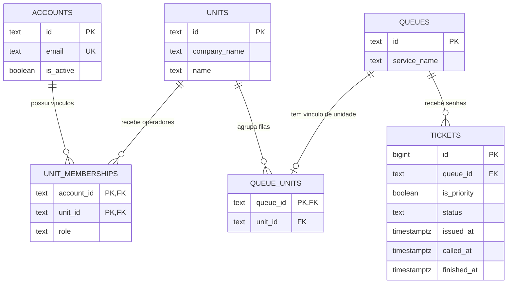

# Checkpoint 4.1 — Identidade e operação por unidade

A revisão conjunta partiu dos vínculos observados no DBeaver. A mesma conta
aparecia em duas linhas porque cada linha descrevia sua atuação em uma
unidade. Ao comparar esse resultado com a jornada empresarial, confirmou-se
que a identidade da pessoa é única e que a responsabilidade operacional
depende do local em que ela atua. O modelo foi aprovado com um papel por
conta em cada unidade.

## Relações do modelo



PK identifica o registro, FK referencia outro registro e UK indica um valor
único. O par conta–unidade identifica cada vínculo. Uma unidade pode reunir
várias filas, e cada fila admite até um vínculo de unidade. Cada senha
pertence a uma fila e conserva sua identidade da emissão à conclusão.
O piloto admite um atendimento ativo por fila. Filas diferentes podem
atender em paralelo.

## Validação da regra de negócio

| Conta fictícia | Unidade | Papel | Operação prevista |
| --- | --- | --- | --- |
| demo-centro | Centro | Recepção | Emitir senha de balcão. Confirmar pré-check-in quando a jornada do checkpoint 5 estiver integrada. |
| demo-norte | Norte | Profissional | Chamar e concluir na fila autorizada. |
| demo-multi | Centro | Administrador | Executar as operações administrativas de atendimento no Centro. |
| demo-multi | Norte | Profissional | Chamar e concluir na fila autorizada do Norte. |

O caso multivínculo demonstra por que a função precisa ser avaliada por
unidade. Uma mudança de unidade pode mudar as operações disponíveis sem
exigir outra conta. O checkpoint 4.1 registra essa relação. O 4.2 aplicará
as permissões na API e no WebSocket com contas de teste. O cadastro de
empresas, a criação de unidades e os convites pela interface permanecem
como etapas próprias.

## Crescimento para várias empresas

O cenário discutido reúne três empresas fictícias com duas unidades cada.

```text
Clínica Vida
├── Unidade Centro → filas de atendimento
└── Unidade Norte  → filas de atendimento

Laboratório Alfa
├── Unidade Centro → filas de coleta
└── Unidade Sul    → filas de coleta

Clínica Horizonte
├── Unidade Leste  → filas de atendimento
└── Unidade Oeste  → filas de atendimento
```

O esquema atual comporta as seis unidades e seus vínculos. Unidades com
nomes iguais continuam distintas por identificador. Para agrupar filiais
formalmente, a evolução proposta é criar uma entidade de empresa e associar
cada unidade ao seu identificador. Permissões para criar filiais ou consultar
relatórios consolidados devem ser definidas no nível da empresa. A operação
de uma filial continua baseada no vínculo da unidade.

A abertura de um novo local acrescenta unidades, filas e vínculos. A
expansão do atendimento acrescenta senhas às filas existentes. Se vários
profissionais precisarem atender a mesma fila simultaneamente, será
necessário representar os postos de atendimento e rever a regra de um
atendimento ativo por fila.

## Evidências e aceite

A suíte registrou 63 testes aprovados com PostgreSQL, incluindo migração
em schema vazio, preservação de senha ativa e reaplicação da migração e
dos dados fictícios. A revisão manual confirmou no DBeaver os vínculos
distintos da conta multivínculo. O responsável aprovou o checkpoint após
conferir a coerência entre as relações e o fluxo de negócio. O registro
usa somente exemplos fictícios.
